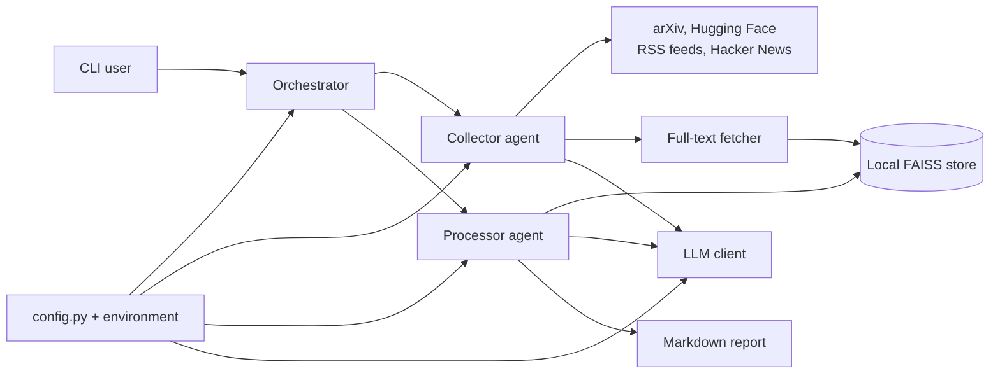

# AI Research Assistant — Design Document

## 1. Purpose and scope

This Python command-line application finds recent research about a configurable topic, evaluates a pool of candidate papers, and writes a dated Markdown briefing. The default topic is Agentic AI and the default publication window is 14 days.

The design favors a small, locally persisted pipeline with explicit code-level selection rules. Language models help discover candidates, assess evidence, and synthesize the final brief. Source metadata, date filtering, ranking, pool limits, and report assembly are handled by ordinary Python code.

## 2. System context

The system runs locally except for its configured LLM provider and public research-source requests. The vector database is stored under `vector_db/` by default; reports are written under `reports/`.

## 3. Runtime architecture

### Orchestration

`research_agent_orchestrator.py` is the entry point. It parses command-line overrides, applies them to `config`, then imports the agents so their defaults see the final settings. It opens or creates the vector database, optionally clears it for `--fresh`, builds one shared LLM client, runs collection unless `--skip-collect` is set, and then runs processing. It reports elapsed time, selected count, and accumulated LLM token usage.

The pipeline is sequential between agents: A2 starts only after A1 completes. During A2, per-paper evaluations run concurrently using a thread pool. `EVAL_WORKERS` controls that concurrency.

### A1 — Collector

`collector_agent.py` drives a provider-neutral tool loop using the collector prompts and schemas defined in `prompts.py` and `tools.py`. The model can search arXiv, retrieve Hugging Face Daily Papers and lab RSS posts, check Hacker News discussion, and submit candidate IDs for storage.

Search results are registered in an in-memory ID registry. `store_candidates` accepts only registered IDs and rechecks the look-back window. Each accepted item is fetched best-effort as full text, chunked, embedded, and persisted. If the model stores fewer than `MIN_CANDIDATES_TO_STORE`, A1 tops up from items it has shown using engagement and venue signals. Storage is capped at `MAX_CANDIDATES_TO_STORE`.

### Source adapters and document retrieval

`tools.py` implements deterministic source integration:

- arXiv Atom API search, filtered by configured categories and publication window;
- Hugging Face Daily Papers API, including community engagement metadata;
- configured RSS/Atom feeds for lab and research news;
- Hacker News Algolia search for discussion signals;
- HTML-to-text extraction and best-effort paper/blog full-text retrieval.

Retrieval failures are generally logged and skipped, or use title and abstract as fallback text. The source adapters do not call an LLM.

### Shared vector store

`vector_store.py` owns the local FAISS index and its JSON sidecars. Documents are split into overlapping character chunks. Embeddings use either an optional Sentence Transformers model or the built-in deterministic hashing embedder. Vectors are normalized and queried using inner-product cosine similarity. The embedder name and vector dimension are stored in a manifest; opening a database rebuilds the matching embedder and checks the dimension.

The on-disk database contains:

| File | Contents |
|---|---|
| `manifest.json` | Embedder identity, dimension, creation/clear time, next chunk ID |
| `index.faiss` | Vector index keyed by chunk ID |
| `chunks.json` | Chunk ID, parent paper ID, chunk order, text |
| `papers.json` | Source metadata, signals, candidate note, and chunk IDs |

Per-paper retrieval restricts similarity search to that paper's chunk IDs. General retrieval searches the full index. A paper ID already in the store updates metadata without replacing its original chunks.

### LLM abstraction

`llm_client.py` defines three operations used by agents: plain text completion, validated structured completion, and tool-loop execution. `ClaudeClient` uses the Anthropic SDK and supports Claude-specific effort, adaptive thinking, streaming, and optional refusal fallback. `OpenAICompatibleClient` calls a Chat Completions endpoint over HTTP; it asks for schema-constrained JSON when supported, validates results with Pydantic, and makes one repair attempt after invalid output.

Both clients maintain usage counters. Agents depend on the shared interface rather than a provider SDK. The same client instance is shared across parallel A2 evaluation tasks.

### A2 — Processor and report writer

`processor_agent.py` loads stored papers and applies the publication-window filter again. For each in-window paper, it retrieves relevant chunks and requests a `PaperEvaluation` structured response. Evaluation failures are isolated to the affected paper; if every evaluation fails, processing stops with an error.

Each successful evaluation contains an on-topic flag, contribution type, four 1–10 criterion scores, rationale, selection explanation, and takeaway. Python computes the weighted score using `CRITERIA_WEIGHTS`, filters off-topic and below-threshold items, selects up to `TOP_N`, and attempts to satisfy the configured survey, empirical, and reframing mix without selecting below-threshold papers. The brief writer then receives the selected-paper digest and retrieved excerpts. Finally, the processor renders the report and `tools.write_markdown_report` writes `ai-research-YYYY-MM-DD.md`.

The report includes the executive brief, coverage notes, ranked reading list, details and scores, and an appendix listing evaluations and exclusions. Titles, author names, publication dates, sources, and URLs are taken from stored source records; model output supplies evaluation and synthesis text.

## 4. Main data flow

1. CLI options and environment settings are loaded into `config.py`.
2. The orchestrator initializes the vector store and selected LLM backend.
3. A1 calls source tools; results become source-backed candidate records in memory.
4. A1 chooses records and stores fetched text plus metadata in FAISS and JSON files.
5. A2 filters the stored records by date, retrieves per-paper context, and evaluates candidates.
6. Deterministic Python ranking applies weights, quality threshold, top-N cap, and breadth rules.
7. The LLM writes a synthesis from selected-paper excerpts; Python adds source metadata and renders Markdown.
8. The dated report is written to the configured output directory.

## 5. Key design decisions

- **Two distinct agent responsibilities:** collection searches and builds a broad pool; processing evaluates and selects. This keeps broad discovery separate from consistent rubric application.
- **Code-enforced constraints:** candidate IDs must come from tool results; pool size, date checks, score threshold, top-N limit, and much of selection are enforced outside the model.
- **Structured evaluation:** Pydantic validation gives downstream ranking stable field types and allowed contribution categories.
- **Provider isolation:** the LLM interface allows Claude and OpenAI-compatible servers to share agent logic.
- **Local persistence:** FAISS plus JSON makes the small corpus inspectable and reusable between runs without a database service.
- **Graceful degradation:** source and per-candidate failures are isolated where possible; abstract-only content can still be processed.

## 6. Configuration and operation

`config.py` centralizes domain, date window, model settings, source lists, scoring weights, embedding settings, storage paths, concurrency, and report output. Most runtime choices can be overridden through environment variables; the orchestrator exposes common choices as CLI flags. `--lite` changes candidate and context limits and forces serial evaluation for smaller or slower local models.

The scripts in `scripts/` create, clear, and delete the vector database. `--fresh` clears its contents before a run. `--skip-collect` processes existing stored candidates. If the database was created with one embedder, switching embedding model requires recreating it.

## 7. Failure handling and operational boundaries

- Individual feed failures are logged and skipped; HF fetch failures are isolated per day.
- Full-text download failures fall back to title and abstract.
- Tool exceptions are returned to the model as tool errors so it can continue.
- A collector loop that fails after source results have been exposed can still finish using the candidates already seen and may top up.
- A2 records individual evaluation failures as exclusions; all-evaluation failure aborts the report run.
- LLM calls include retries/timeouts and provider-specific error messages.
- The store writes each index/JSON component separately. JSON writes use temporary files and replacement, but the collection of files is not a single transaction.
- The output filename is date-based; another run on the same date overwrites that report.

## 8. Design review: current limitations and risks

These observations describe the implementation as it exists; they are not claims that the pipeline is unusable.

1. **Date filtering has no upper bound.** `tools.in_window` checks that a date is after the window start but does not reject future-dated records. This differs from the stated “within the last N days” intent. The filter and report date also mix UTC calculations with the machine's local `date.today()` for the report heading and filename.
2. **Prompt-injection boundary is implicit.** Retrieved abstracts, full text, and blog content are included in model prompts. The prompts tell the model to score from that text, but the content is not explicitly marked as untrusted data or prohibited from changing instructions. Source text could therefore influence evaluator or synthesis behavior.
3. **Existing records retain stale text.** Re-adding a paper ID refreshes metadata but deliberately keeps its original chunks. Updated abstracts or full text will not be reflected until the database is cleared/rebuilt.
4. **Multi-file persistence is not atomic.** A failure between writing the FAISS index and JSON files can leave files from different logical states. `VectorStore.exists` checks only for the manifest and index, so incomplete sidecar state may be noticed later during open or access.
5. **Breadth swaps can be order-sensitive.** Required contribution types are processed in a fixed sequence. A later swap can displace an earlier type in some edge cases; final selection does not run a separate invariant check that all available breadth requirements remain represented.
6. **Source quality and coverage vary.** Collection breadth depends on source availability, search phrases chosen by the model, and result caps. Blog/RSS dates and full-text extraction are best-effort; the default hashing embedder is lexical rather than semantic.
7. **Hosted inference sends prompt data externally.** With a hosted LLM provider, source metadata and retrieved text are transmitted to that provider. The local vector store remains on disk, but the prompt contents leave the machine for inference.
8. **Report overwrite and output trust.** The same-day report path is reused. Table cells receive limited Markdown escaping; URLs and ordinary Markdown prose come from sources/model output and are not treated as a sanitized publishing surface.

## 9. Potential follow-up improvements

If the project is extended, high-value changes would be to enforce both ends of a single UTC date window, explicitly delimit source text as untrusted in all prompts, validate the breadth invariant after selection, and persist a run ID or timestamp to avoid same-day report replacement. A store manifest/version check across all four files and a refresh policy for previously stored chunks would also improve recovery and reproducibility.

## 10. Module map

| Module | Responsibility |
|---|---|
| `research_agent_orchestrator.py` | CLI, configuration overrides, pipeline lifecycle |
| `collector_agent.py` | Candidate search loop, registry, validation, storage, top-up |
| `processor_agent.py` | Structured evaluation, ranking, synthesis, report rendering |
| `tools.py` | Source APIs, date helpers, text extraction, report output, tool schemas |
| `vector_store.py` | Chunking, embedding, FAISS and metadata persistence/retrieval |
| `llm_client.py` | Provider adapters, retries, schema validation, tool loops, usage |
| `prompts.py` | Prompt fragments and agent-specific system/user prompts |
| `config.py` | Runtime settings and defaults |
| `scripts/` | Vector database create, clear, and delete operations |
